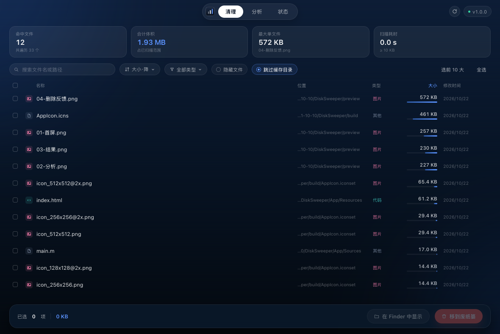
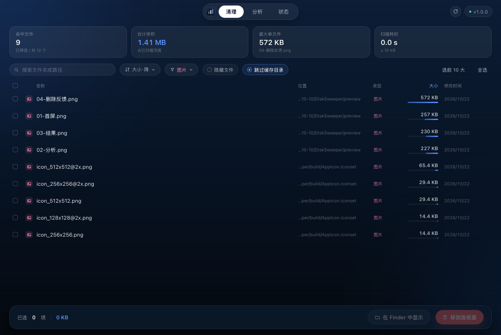
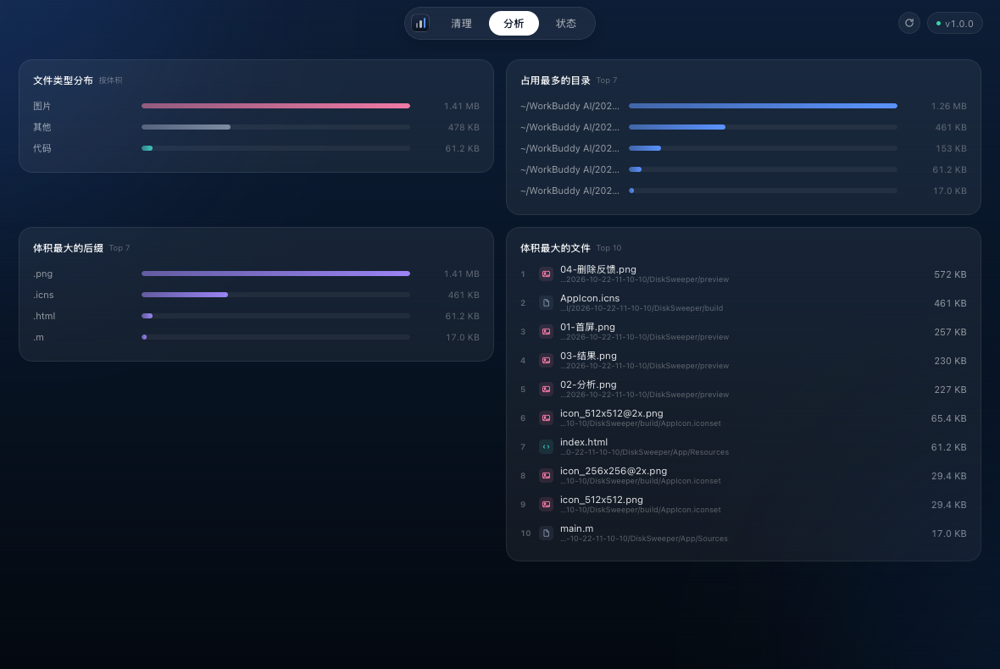
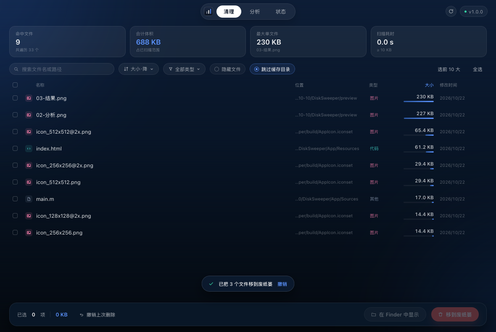

# 清盘 · DiskSweeper

**把 Mac 上的文件按体积排好队，勾选即可批量清理。**

一个原生 macOS 小工具：扫描本机文件 → 按体积从大到小排序 → 批量勾选 → 一键移到废纸篓（可撤销）。


## 特性

- **按体积降序，默认就是你要的顺序** — 打开就知道谁在吃硬盘。
- **批量选择** — 单击勾选、`Shift` 连选、`⌘A` 全选、一键「选前 10 大」。
- **一键清理 + 撤销** — 删除只走废纸篓，底部提示「撤销上次删除」，误删也能救回来。
- **三种扫描范围** — 个人文件夹 / 全电脑（自动跳过系统目录）/ 自选任意文件夹。
- **类型筛选与排序** — 图片、视频、音频、压缩包、PDF、文档、代码… 可按类型、时间、体积、名称排序，任一排序下默认都是体积从大到小。
- **分析页** — 文件类型分布、占用最多的目录、体积最大的后缀、Top 10 大文件。
- **状态页** — 磁盘余量、扫描设置、安全说明。
- **本地离线** — 只读取体积与修改时间，不上传任何内容。



| 按类型筛选 | 分析页 |
| --- | --- |
|  |  |



## 安装

### 方式一：下载 DMG

1. 在 [Releases](../../releases) 下载 `DiskSweeper-1.1.0.dmg`。
2. 双击挂载，把 **清盘.app** 拖到旁边的 **Applications** 文件夹。
3. 首次打开若提示「无法验证开发者」：右键 → 打开，或在「系统设置 → 隐私与安全性」里点「仍要打开」。

> 自己编译的版本不会有这个提示。

### 方式二：自己编译（无需 Xcode）

只需要命令行工具（`xcode-select --install`）：

```bash
git clone https://github.com/Heya-Arsa/qingpan.git
cd qingpan
./build.sh                 # 生成 build/清盘.app
cp -R build/清盘.app ~/Applications/

./make_dmg.sh              # 可选：打包成 build/DiskSweeper-<版本>.dmg
```

`build.sh` 会生成图标、编译并做 ad-hoc 签名；`make_dmg.sh` 会打出带「拖到 Applications」快捷方式的安装镜像。

## 使用

1. 打开 App，点中间白色的 **扫描 Mac**。
2. 首次扫描「桌面 / 文稿 / 下载」时，macOS 会询问文件夹访问权限，**点允许**，否则这些目录会被跳过。
3. 结果默认按体积降序。点行勾选，`Shift + 点击` 连选，`⌘A` 全选；顶部可切换排序、按类型筛选、搜索文件名或路径、调整体积门槛。
4. 选好后点右下角 **移到废纸篓** → 二次确认（会列出文件和合计体积）→ 完成。
5. 想反悔就点提示条上的 **撤销**，文件会原路还原。

### 三种扫描范围

| 范围 | 说明 |
| --- | --- |
| 个人文件夹 | 默认。扫描 `~`，最快，日常清理够用 |
| 全电脑 | 扫描 `/`，自动跳过 `/System`、`/usr`、`/Volumes`、`/private/var` 等系统位置，通常 1–2 分钟 |
| 自选文件夹 | 挑任意目录，比如某个外接硬盘 |

## 安全设计

- **只走废纸篓**，不做永久删除；删除后可立即撤销，也能随时从废纸篓恢复。
- **只读元数据**：体积、修改时间、路径。不读取文件内容，不联网，不上传。
- **默认跳过缓存与依赖目录**：`Caches`、`node_modules`、`DerivedData`、`.git` 等，可在界面关闭。
- **不碰符号链接**，系统目录与受保护位置自动跳过。
- 删除前一定二次确认，并显示合计体积。

## 实现说明

- **原生窗口（AppKit）+ WKWebView**：窗口、扫描、废纸篓、撤销在 Objective-C 侧完成，界面用单文件 HTML/CSS/JS 渲染，通过 `postMessage` / `evaluateJavaScript` 双向通信。
- 扫描用 `NSDirectoryEnumerator` 在后台线程遍历，进度每 0.1 秒节流回传，命中数上限 30 万。
- 删除用 `NSFileManager -trashItemAtURL:`，同时记录原路径与废纸篓路径，撤销时 `moveItemAtPath:` 还原。
- 为什么是 Objective-C：只需要 Command Line Tools 就能编译，不依赖 Xcode 工程，clone 下来 `./build.sh` 就能出 App。

## 目录结构

```
qingpan/
├── App/
│   ├── Sources/main.m          # 窗口、扫描、废纸篓、撤销、JS 桥
│   └── Resources/index.html    # 全部界面与交互
├── tools/gen_icon.py           # 纯 Python 生成 AppIcon.icns
├── Info.plist
├── build.sh                    # 编译 App
├── make_dmg.sh                 # 打包 .dmg
├── preview/                    # 截图
└── docs/GITHUB上传说明.md       # 上传到 GitHub 的步骤
```

## 环境要求

- macOS 12 或更高（在 macOS 26 上开发测试）
- 编译需要 Command Line Tools；运行不需要任何依赖

## Roadmap

- [ ] 目录体积聚合（按文件夹看占用）
- [ ] 重复文件检测
- [ ] 扫描结果导出 CSV
- [ ] 深色 / 浅色主题切换

## 许可

[MIT](LICENSE)
